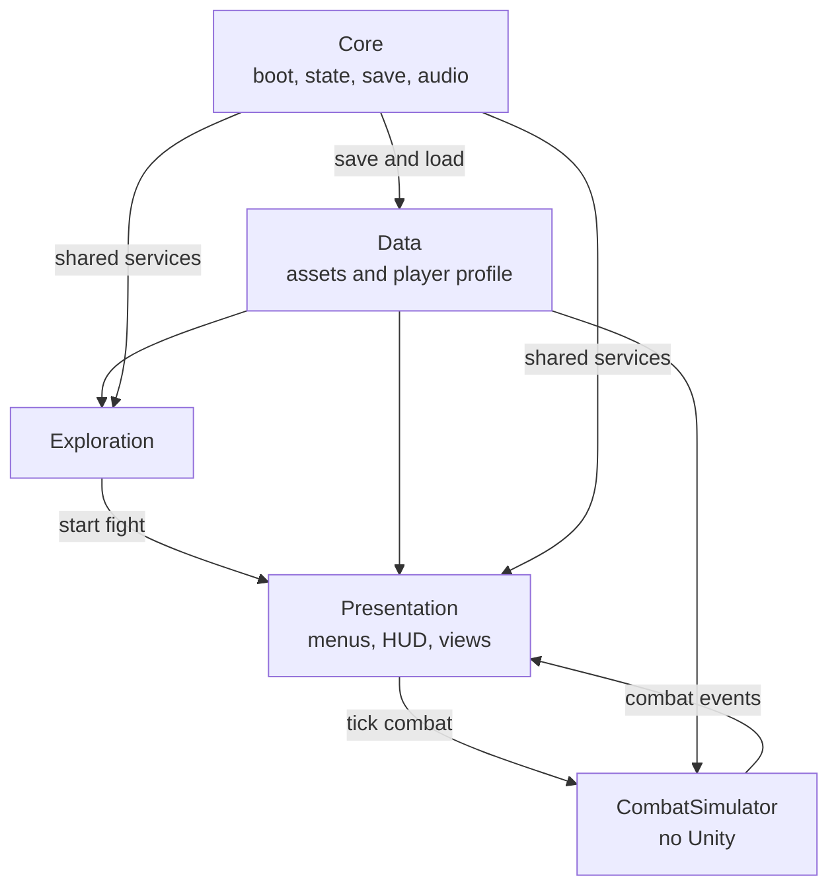
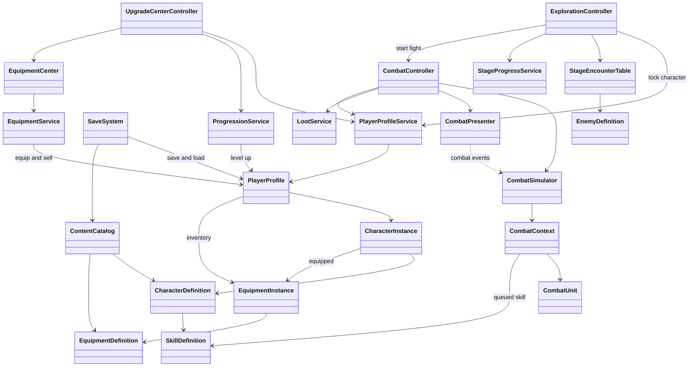

# Immortal Road

A 2D auto-battle RPG. Players travel an endless road and spend energy to cast skills during battles. Class and gear decide how far the stages can go.

**Genre:** Idle RPG / Auto-battle RPG  
**Platform:** PC / Web  
**Engine:** Unity 6

## Overview

- Multiple classes with distinct stats, gear, and skills
- ATB turn order based on speed
- Upgrade center to level up, replace gear, and switch characters
- Each win leads to a harder stage

## Architecture

- The combat simulator stays separate from Unity. The UI listens to combat events, and boot registers the shared services.

## Class diagram

- Diagram shows the core classes.

## Scope

#### v1
- One character fights at a time.
- Three classes are playable.
- Each character has one active skill.
- Skills and attacks choose random targets.
- The Settings menu is not implemented yet.

#### Next (v2)
- A short victory moment before the result screen.
- Enemy hit, attack, and death feedback.
- A second skill for each character, with target keywords.
- Epic and Legendary gear in later stages.
- Music in the upgrade center and in battle.
- A Settings menu.

## Credits

### Design and code

- Solo project

### UI and icons

- [Hyper Casual UI Pack](https://assetstore.unity.com/packages/2d/gui/hyper-casual-ui-pack-375832)
- [500 Free Skill Icons](https://assetstore.unity.com/packages/2d/gui/icons/500-free-skill-icons-344112)
- [110 Free Armor and Jewelry Icons](https://assetstore.unity.com/packages/2d/gui/icons/110-free-armor-and-jewelry-icons-243902)
- [Pixel UI Fantasy — Free RPG GUI Sampler](https://assetstore.unity.com/packages/2d/gui/pixel-ui-fantasy-free-rpg-gui-sampler-412098)

### Art

- Some images from 新仙劍奇俠傳 (Softstar, 2001)
- Some images generated with AI

### Audio

- Some sound effects from 新仙劍奇俠傳 (Softstar, 2001)
- [Taira Komori free sound effects](https://taira-komori.net/freesoundtw.html)

### Fonts

- [Born2bSporty FS](https://www.1001fonts.com/born2bsporty-fs-font.html)